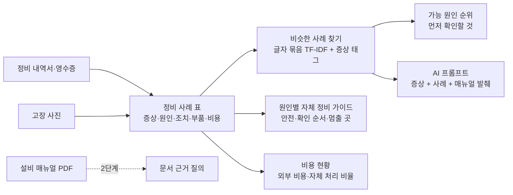

# 설비고장 원인 및 진단파악(AI) — 프로젝트 기획서

| 항목 | 내용 |
|---|---|
| 리포 | data10-06 |
| 제출자 | 유상진 |
| 직무·소속 | 부자재생산팀 (회사명 생략) |
| 과정 | 현장 데이터 디지털화 전문가과정 2차수 |
| 작성일 | 2026-10-20 |
| 문서 상태 | 초안 v0.1 — 수강생 제출 자료 기반 |

---

## 1. 추진 배경과 현안

- 숙련자들이 퇴사한 뒤 남은 인력은 근속년수가 짧아, 설비가 고장 나면 대처하기 어렵습니다.
- 가장 답답한 점은 **고장 원인 자체를 모른다는 것**입니다.
- 그래서 매번 외부 수리 인력을 부르게 되고, 수리 비용이 계속 늘고 있습니다.
- AI 를 활용해 고장 원인을 팀 안에서 먼저 짚고, 점점 팀의 자체 수리 능력을 키워 외부 수리 비용을 줄이고자 합니다.

외부 업체가 고치고 간 내용은 정비 내역서·영수증으로 남아 있지만, 표로 모여 있지 않아 「지난번에 같은 증상일 때 무엇이 원인이었는지」 를 찾아 쓰기 어려운 상황으로 보입니다(가정).

## 2. 목표

### 2.1 최종 목표

- **고장 원인 진단 챗봇** — 현장 작업자가 「온도가 안 올라가고 기계가 멈춤」 처럼 증상을 넣으면, 과거 유사 사례를 근거로 「히터 단선 또는 센서 불량일 가능성이 높으니 우선 센서 연결부터 확인」 처럼 원인과 먼저 확인할 것을 짚어 줍니다.
- **초보자용 자체 정비 가이드북** — 외부 수리 기사가 고치고 간 내역이 쌓일수록 원인별 정비 순서가 자라서, 간단한 부품 교체·조치는 초보자도 따라 할 수 있게 안내하는 팀 전용 가이드북.
- 외부 수리 비용을 줄이는 것 — 비용과 자체 처리 비율의 변화를 숫자로 확인합니다.

### 2.2 1차 개발 목표

1차는 **정비 내역을 표로 모으는 것**에서 시작합니다. 사례집이 있어야 진단도 가이드도 근거가 생기기 때문입니다.

- 정비 사례 등록(증상·원인·조치 단계·교체 부품·외부/자체·비용·사진)과 정비 내역서 엑셀 일괄 가져오기
- 증상 → 비슷한 과거 사례 → 가능 원인 순위와 「먼저 확인할 것」 (과거 사례 기반 추정)
- 사례에서 원인별 자체 정비 가이드 카드 초안 자동 생성(고칠 수 있고 인쇄 가능)
- 외부 수리 비용·건수와 자체 처리 비율 현황
- 더 풍부한 답이 필요하면 증상 + 비슷한 사례 + 매뉴얼 발췌를 묶은 **AI 프롬프트를 만들어 회사가 허용한 AI 에 붙여 넣는 반자동** 방식

## 3. 보유 데이터

| 데이터 | 형태 | 규모·주기 | 비고(민감도 등) |
|---|---|---|---|
| 고장 현장 사진·동영상 | 이미지·영상 파일 | 미상 — 기계 멈춤·이상 소음 때마다 | 찍은 날·설비·증상 메모가 함께 있는지 확인 필요 |
| 외부 업체 정비 내역서 | 종이 또는 PDF로 가정 | 미상 | 업체 이름·담당자 이름 포함 — 리포에는 넣지 않음 |
| 수리 영수증 | 종이 또는 PDF로 가정 | 미상 | 금액 확인용 |
| 설비 매뉴얼 | 미상 | — | 아직 받지 않음(10장) |

제출 원문에 첨부 파일은 없습니다. 1단계는 같은 모양의 **가상 사례 30건(설비 A~E)** 으로 만들었고, 실제 자료를 받으면 열 맞추기와 원인 이름 묶기를 실제 표기에 맞춥니다.

## 4. 해결 방안 개요

| 단계 | 내용 |
|---|---|
| 수집 | 정비 내역서·영수증(엑셀로 옮기거나 한 건씩 등록), 고장 사진 |
| 정리 | 열 맞추기로 공통 항목(일자·설비·증상·원인·조치·부품·외부/자체·비용·시간)에 맞추고, 같은 원인을 다르게 적은 것(히터 끊김·히터밴드 단선)을 대표 이름으로 묶음 |
| 분석 | 증상 글의 비슷한 정도(한국어 글자 2개 묶음 TF-IDF) + 증상 태그 + 같은 설비로 과거 사례를 찾고, 원인별로 묶어 비중을 냄 |
| AI | 증상 + 비슷한 사례 + 매뉴얼 발췌로 원인·확인 순서·멈출 기준을 묻는 프롬프트 (1단계는 반자동, 선택: 본인 키로 OpenAI 호환 서버에 자동 보내기) |
| 산출물 | 증상 진단 화면, 정비 사례집(엑셀), 원인별 자체 정비 가이드북(인쇄), 비용 현황 |

## 5. 주요 기능

| 기능 | 설명 | 우선순위 |
|---|---|---|
| 정비 사례 등록 | 설비·일시·증상 문장·증상 태그·원인·조치 단계·교체 부품·필요 공구·외부/자체·비용·소요시간·사진(줄인 사본)·영상 위치 | MVP |
| 정비 내역서 엑셀 가져오기 | 열 이름이 달라도 열 맞추기로 연결, 연결 저장, 「1) 2)」 한 칸을 단계로 나누기, 금액·시간 글자 읽기, 같은 건 건너뛰기 | MVP |
| 증상 진단 | 비슷한 과거 사례 순위, 원인별 비중·근거 사례 수, 「먼저 확인할 것」(사례의 첫 확인 단계), 과거 사례 기반 추정임을 표시 | MVP |
| AI 프롬프트 | 증상 + 비슷한 사례 + 원인 순위 + 매뉴얼 발췌, 초보자 안전 지시 포함. 복사 → 붙여 넣기 | MVP(반자동) |
| 자체 정비 가이드북 | 원인별 카드 — 증상, 안전 먼저(전원 차단·잠금 LOTO 표준 문구), 확인 순서, 초보자가 멈출 곳, 필요 공구·부품, 외부 수리 필요 기준. 고치기·인쇄·AI 다듬기 | MVP |
| 비용 현황 | 월별 외부 수리 비용·건수, 설비별·원인별, 자체 처리 비율 변화, 자체 처리 전환 후보 | MVP |
| 매뉴얼 근거 질의(RAG) | 매뉴얼 PDF 의 알람·고장 대응 표를 근거로 답 | 확장 |
| 팀 공유 저장소 | 여러 사람이 같은 사례집을 쓰기 | 확장 |
| 사진 기반 부위·증상 설명 | 사진이 모이면 | 확장 |

## 6. 기대 산출물

1. **정비 사례집** — 표로 정리된 「증상 → 원인 → 조치」 (엑셀 내보내기)
2. **증상 진단 화면** — 가능 원인과 먼저 확인할 것, AI 프롬프트
3. **자체 정비 가이드북** — 원인별 카드, 인쇄용
4. **비용 현황** — 외부 수리 비용과 자체 처리 비율의 변화
5. **매뉴얼 근거 질의·팀 공유** — 2단계 (확장)

## 7. 기술 구성

| 과정 도구 | 이 프로젝트에서 쓰는 곳 |
|---|---|
| DAY1 암묵지 자산화·전략기획 | 퇴사한 숙련자·외부 기사가 「무엇부터 봤는지」 를 정비 단계로 꺼내 적기, 초보자가 해도 되는 일과 멈출 선 정하기 |
| DAY2 코랩(Python)·바이브코딩 | 정비 내역서 표 정리, 원인 이름 묶기, 유사도 계산, 브라우저 도구 제작 — 1단계의 중심 |
| DAY3 멀티모달 비정형 정보화 | 종이 내역서·영수증 사진에서 항목 뽑기, 고장 사진 설명 (2단계) |
| DAY4 RAG (Dify, NotebookLM) | 설비 매뉴얼을 근거로 한 고장 원인 질의 (2단계) |
| DAY5 Make 자동화 | 정비 사례 등록 알림·월간 비용 보고 (확장, 보안 허용 시) |
| 생성형 AI | 원인·확인 순서 설명, 가이드 문장 다듬기 (1단계는 프롬프트 생성 반자동) |

**개발 형태(권장)**

- 1단계는 **설치 없이 브라우저에서 도는 정적 웹 도구**입니다. 정비 사례·사진은 이 브라우저 안에만 저장하고 서버로 보내지 않습니다. 진단·가이드·비용은 규칙 계산이라 AI 서비스 없이도 돕니다.
- AI 는 프롬프트만 만들어 복사하는 반자동이 기본입니다. 회사가 허용한 AI 에만 붙여 넣으면 됩니다. 본인 키로 OpenAI 호환 서버에 자동으로 보내는 설정은 선택입니다(키는 코드에 없음).
- **안전**: 진단은 확정이 아니라 과거 사례 기반 추정입니다. 가이드는 늘 전원 차단·잠금(LOTO)으로 시작하고, 전기 측정·배선, 유압 라인 분리·교체, 고온부 분해는 「담당자·전문가」 단계로 표시해 초보자가 그 앞에서 멈추게 합니다.

## 8. 개발 단계

### 1단계 — 지금 개발 가능한 부분

정비 내역서 원본이 없어도 **사례 표 하나만 있으면** 쓸 수 있는 기능을 먼저 만듭니다. 받기 전에는 가상 사례로 만들고, 받으면 열 맞추기와 원인 이름 묶기만 맞춥니다.

- 정비 사례 등록(사진 포함) + 정비 내역서 엑셀 가져오기(열 맞추기·연결 저장)
- 증상 진단 — 비슷한 사례·가능 원인 비중·먼저 확인할 것, 「과거 사례 기반 추정」 표시
- 증상 + 비슷한 사례 + 매뉴얼 발췌를 묶은 AI 프롬프트(복사 → 붙여 넣기)
- 원인별 자체 정비 가이드 카드 자동 초안(안전·확인 순서·멈출 곳·공구·부품·외부 기준), 고치기·인쇄
- 외부 수리 비용·자체 처리 비율 현황
- 시험용 가상 사례 30건(설비 A~E)에는 자주 나는 고장 다섯 가지(히터 단선·온도 센서 불량·유압 누유·모터 과부하·금형 막힘)를 되풀이해 넣고, 같은 원인을 다르게 적은 표기를 섞어 묶기와 진단이 맞는지 확인합니다.

### 2단계

- 실제 정비 내역서로 사례집 만들기 — 열 맞추기·원인 이름 묶기를 실제 표기에 맞춤
- 설비 매뉴얼 PDF 의 알람·고장 대응 표를 근거로 한 질의(NotebookLM·Dify 부터)
- 팀 공유 저장소(사내 환경 확인 후)
- 사내에서 팀원이 해도 되는 작업의 선을 가이드에 반영

### 3단계

- 고장 사진으로 부위·증상 설명 초안
- 사내 허용 AI 와 직접 연결한 진단 대화(챗봇)

## 9. 기대 효과

- **원인을 먼저 짚음** — 외부를 부르기 전에 과거 사례에서 가능성 높은 원인과 먼저 볼 곳을 압니다.
- **외부 수리 비용 감소** — 자체로 고친 적이 있는 고장부터 팀이 처리하도록 가이드를 공유하고, 비용 현황으로 변화를 확인합니다.
- **숙련 지식 보존** — 외부 기사가 고치고 간 순서가 사례로 쌓여 팀의 자산이 됩니다.

제출 자료에는 정량 수치가 없어 이 문서도 목표 수치를 적지 않습니다.

## 10. 확인 필요 사항

> 패들릿 댓글로 이미 요청했습니다. 받으면 11장에 반영합니다.

**자료 (필수)**

1. 대상 설비 목록 — 설비명·모델·제조사
2. 설비 매뉴얼 PDF — 특히 알람 목록·고장 대응 표
3. 외부 정비 내역서 5~10건 — 증상·원인·조치·교체 부품·금액이 보이게(업체·담당자 이름은 가림)
4. 고장 사진·영상과 증상 메모 — 찍은 날·설비·무엇이 이상했는지

**판단 기준**

5. 자주 나는 고장 상위 3~5가지 — 가상 예시의 다섯 가지와 맞는지
6. 사내 규정상 팀원이 직접 해도 되는 작업과 반드시 외부를 부르는 작업(전기·유압·고온)

**보안·환경**

7. 정비 내역·사진을 외부 AI 나 클라우드에 올려도 되는지, 사내에서 허용된 AI 가 있는지
8. 도구를 혼자 쓰는지, 팀이 함께 쓰는지(공유 저장소 필요 여부)

시작점은 **정비 내역을 표로 정리해 「증상 → 원인」 사례집을 만드는 것**입니다. 도구의 「정비 사례 → 빈 양식 받기」 에 5~10건만 옮겨 적어도 진단·가이드가 동작합니다.
